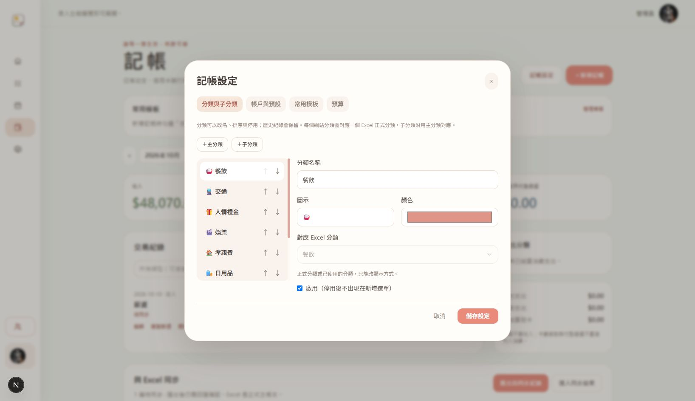

# 記帳客製化

入口：`/dashboard/finance` 的「記帳設定」。設定依登入會員保存於資料庫，重新整理或換裝置仍可讀取；儲存會檢查版本，避免另一分頁的變更被覆蓋。

## 分類與帳戶

- 新增主分類及子分類，修改名稱、圖示與顏色，調整排序或停用。
- 正式九類的對應需保留。新增分類可對應既有正式分類，例如早餐／午餐對應餐飲。子分類沿用主分類對應，最多兩層。
- 停用後不出現在新增選單，歷史分類和已存在的交易仍可檢視及編輯。已使用的分類不可移除或改變正式對應。
- 國泰／中國信託／現金錢包可改顯示名稱、排序、停用；CUBE 可改名稱。可設定預設銀行帳戶、支付方式與支出分類。現金支出預設使用錢包，既有兩帳戶設定讀取時相容補上錢包，舊帳目不自動改寫。預設項目必須啟用。
- 交易清單新增分類複選，選取主分類會包含其子分類；搜尋也支援分類名稱。

## 常用模板及重複記帳

- 新增／編輯表單勾選「存成常用模板（本次不入帳）」，按「儲存模板」只儲存模板。
- 點首頁模板帶入表單，檢查當日金額與內容後才儲存交易。模板旁「編輯」可修改內容與提醒；設定中心可改名、停用與移除模板。
- 支援每週／每月待確認提醒，在記帳頁顯示到期模板；沒有推播、背景排程或自動入帳。
- 確認儲存交易與更新下次提醒在同一資料庫 transaction 中，過期版本會整筆回退；漏掉的月份不自行補帳。
- 每月月底提醒保留原訂日，例如 1/31 → 2/28 → 3/31，閏年為 2/29。
- 「複製新增」使用新的紀錄 ID 與今天日期；不修改原交易。信用卡複製／模板會清除結算連結、已收回補與入帳日期，資金異動清除銀行餘額，需再次確認。

## 預算與報表

- 每月總消費預算及各分類預算，0 表示不設定。顯示剩餘額度及超支狀態。
- 主分類預算含子分類，子分類額度可再獨立提醒；總支出不重複加總。
- 六個月收入／支出趨勢、自訂起訖日期收支與分類明細。期間切換不修改帳務。
- 只計網站有效收入和已結算支出；刪除標記、待結算刷卡、卡費繳款與代墊償還不重複計消費。不是完整 Excel 帳本或銀行餘額。

## Excel 相容性與範圍

`FinanceLedger.preferences/preferencesRevision` 保存網站設定；`FinanceEntry.localCategoryId` 保存本地分類。設定與 localCategoryId 不寫入 finance-changes payload。仍匯出原有 categoryCode／accountId，schemaVersion 維持 1。Excel 回匯改變正式分類時，本地顯示自動以新的正式分類為準，避免舊子分類誤導。

新增正式銀行／卡片、轉帳、退款、分期、外幣與投資仍需擴充帳本交換契約，這次未加入，也未修改正式 Excel adapter。

現金錢包目前限網站本地記帳與 XLSX 歷史副本；v1 交換契約仍只接受既有銀行帳戶，新建錢包支出會明示待支援同步，不以銀行代替。詳細狀態與回退保護見 [finance-history-import.md](finance-history-import.md)。

## 驗證與回退

- Prisma validate、generate、TypeScript、修改範圍 ESLint、mock API 測試通過。測試輸出 24 tests 全數通過，包含既有交換測試及客製化新增的 7 個情境。
- 正式建置通過；最後的分頁入口修正再次建置成功。
- 瀏覽器實際 GET 成功；桌面／390×844 手機分類、預算欄位、模板提醒與複製表單驗證完成。預算／管理模板入口直接開啟對應分頁；日期範圍錯誤顯示提示。
- 瀏覽器只操作未儲存的測試表單並放棄，未新增測試帳務、分類、模板或預算。寫入／回匯以 mock Prisma 驗證，沒有正式 Excel 往返測試。
- 使用者允許後重啟本專案 localhost:1026，未安裝依賴、未執行 migration／db push。
- 回退只撤回本次 preferences、settings、reports、模板及其 API／模型欄位修改；保留先前記帳與行事曆功能。資料庫已存設定與本地分類欄位可保留，不必刪除帳務資料。

