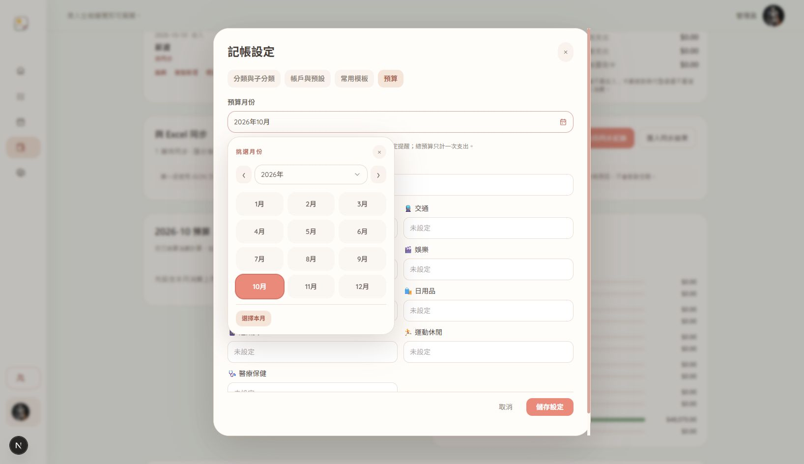

# 共用日期與月份選擇器

`src/components/ui/PersonalDatePicker.tsx` 支援日期與月份兩種模式，受控 value 分別為 YYYY-MM-DD／YYYY-MM，空白為空字串。顯示中文日期，不改既有 API 與 Excel 資料格式。

```tsx
<PersonalDatePicker label="消費日" required value={date} onChange={setDate} />
<PersonalDatePicker label="預算月份" mode="month" required value={month} onChange={setMonth} />
```

- 年份可搜尋，月份直接切換；日期有星期標頭、今天與選取狀態，月份使用十二格。
- 上／下月、上／下年、今天／本月；可留白欄位提供清除按鈕，必填欄位保留原生表單必填驗證。
- 日期方向鍵移動一天／一週，月份移動一個月／三個月；Home／End、PageUp／PageDown、Enter 選取。Tab 可在控制項間移動，Esc 依序關閉年份選單、日期選擇器，保留外層編輯彈窗。
- 固定定位、依可用空間往上或往下顯示，隨滾動與視窗變化調整；透過最近的 PersonalModal 保留焦點範圍。
- PersonalSelect 只新增辨識 data-personal-picker 作為最近 portal host，使年份／月份選單留在日期元件內，其他頁面的使用方式不變。
- 支援 disabled、required、min、max、name、label／ariaLabel、compact 尺寸；dirty 表單應在 onChange callback 標記修改，單純瀏覽年月不會入帳。

此次套用記帳首頁月份、交易日期、信用卡入帳／使用日期與帳單月份、預算月份、模板提醒日與報表起訖日期。其他頁面的原生日期欄位不在本次範圍。

驗證：TypeScript、scoped ESLint（零 warning）、25 tests、Next 正式建置及 git diff --check 通過。新增日期邊界測試涵蓋閏年、月底、跨年與 UTC 日期格；瀏覽器確認 2027 年 2 月、2028/2/29、鍵盤跨月與 Enter、可留白日期清除、Esc 分層與 Tab。390×844 手機月份面板邊界 left37/right377/top307/bottom710、年份選單 left92/right332/top412/bottom792，均在視窗內；測試未保存帳務。

沒有新增依賴、修改模型或重啟服務。回退只撤回本次日期元件／helper、四個 finance 元件的日期欄位替換、PersonalSelect 的 portal host 修改與日期邊界測試；保留前次記帳客製化。


